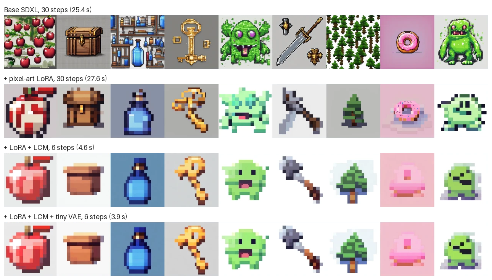

# Pixel-Art

Pixel art generation with a fine-tuned SDXL LoRA, optimised for few-step inference. Features latency/VRAM/quality benchmarks, a custom pixel-grid metric, and a live Gradio demo.



**Live demo:** _TODO: Hugging Face Space link_
**LoRA weights:** [unsupervised-abdullah/pixel-art-sdxl-lora](https://huggingface.co/unsupervised-abdullah/pixel-art-sdxl-lora)

## What this project does

1. **Fine-tunes** Stable Diffusion XL with a LoRA so it draws clean 16x16-style game sprites.
2. **Optimises** inference: 30 sampling steps down to 6 using an LCM distillation LoRA, plus a tiny VAE decoder.
3. **Measures** the trade-off: speed and memory against image quality, including a metric written for pixel art.
4. **Deploys** the fast configuration as a Gradio demo.

## Results

| Config | Steps | Latency (s) | Speed-up | Peak VRAM (GB) | CLIP score | Grid error | Palette size |
|---|---|---|---|---|---|---|---|
| base_30step | 30 | 25.42 | 1.0x | 9.5 | 38.5 | 0.1236 | 74 |
| lora_30step | 30 | 27.63 | 0.9x | 9.6 | 35.6 | 0.0280 | 46 |
| lora_lcm_6step | 6 | 4.64 | 5.5x | 10.0 | 36.3 | 0.0177 | 39 |
| lora_lcm_6step_taesd | 6 | 3.86 | 6.6x | 8.1 | 36.2 | 0.0190 | 40 |

Measured on a single NVIDIA T4 (Kaggle), 1024x1024, fp16, averaged over 9 generations (8 distinct prompts, one repeated with a second seed). Lower is better for latency, VRAM, grid error and palette size; higher is better for CLIP score.

**What the numbers show**

- **6.6x faster:** 25.4 s down to 3.9 s per image, with 1.4 GB less peak VRAM.
- **Much closer to real pixel art:** grid error falls by 85% (0.124 to 0.019) and the palette roughly halves.
- **Small cost in prompt match:** CLIP score drops 2.3 points. Part of that is expected, because a 16x16 sprite carries far less detail for CLIP to recognise than the base model's detailed drawings.
- **The base model draws scenes, not sprites:** it produces piles of apples, shelves of bottles and forests, while the LoRA produces one centred object.
- **The LoRA alone is slightly slower** (27.6 s vs 25.4 s) because it runs as extra layers beside the model. The speed-up comes from few-step sampling.

**Known limitations**

- Backgrounds are not always white; some come out grey, blue or pink.
- Some objects are weak: the donut is washed out and the sword reads more like an axe.
- Outputs are close to the pixel grid but not exactly on it. The demo's "snap to grid" option fixes that last step.
- The benchmark uses a small prompt set, so the scores are indicative rather than precise.

### What didn't work first

The first training run (500 images, 1200 steps, rank 16, captions of the form `pxlsprite, <subject>`) produced blocky but unrecognisable images on grey backgrounds. Grid error improved while CLIP score fell from 38.5 to 33.1 in the 6-step configuration, and the images confirmed the model had learned "big flat blocks" without learning what a sprite is.

Three changes fixed it:

| Problem | Fix |
|---|---|
| Captions relied only on a made-up trigger word | Added a description the base model already understands (`pixel art sprite of ..., white background`) |
| Too little training for a large style change | 1000 images, 3000 steps, rank 32, Min-SNR loss weighting |
| SDXL drifts towards mid-grey images | Noise offset of 0.05 |

The takeaway: grid error alone is misleading, since mushy blocks also score well. It has to be read together with CLIP score and the images.

## How it works

### Data

Training data comes from [Pixel Art Atlas](https://huggingface.co/datasets/Angais/pixel-art-atlas-1.4m) (1.4M captioned 16x16 sprites, CC0). `scripts/prepare_data.py` samples 1000 sprites, one per subject, so the model learns the style rather than a few objects. Each sprite is pasted onto a white background and upscaled to 1024x1024 with nearest-neighbour interpolation, which keeps every sprite pixel as a sharp 64x64 block.

### Fine-tuning

A LoRA (rank 32) is trained on the SDXL UNet with the official `diffusers` script. Only the LoRA matrices are trained; the base model stays frozen, so the result is a small file instead of a multi-gigabyte checkpoint. Every caption has the form `pxlsprite, pixel art sprite of <subject>, white background`: a trigger word plus a description the base model already understands. Training uses Min-SNR loss weighting and a small noise offset, which helps the model produce clean white backgrounds.

### Inference optimisation

| Technique | What it does |
|---|---|
| Half precision (fp16) | Halves memory use and speeds up GPU maths |
| LCM-LoRA | A distillation LoRA that lets the model sample in 4-8 steps instead of 30 |
| Guidance scale 1.0 | Turns off classifier-free guidance, so each step is one UNet pass instead of two |
| Tiny VAE (TAESD) | Replaces the image decoder with a much smaller one |

### Pixel-grid metric

CLIP score says whether an image matches its prompt, but not whether it is real pixel art. `pixelart/metrics.py` adds two measures:

- **Grid error:** average each 64x64 cell, paint the average back, and measure how much the image changed. True pixel art scores 0; blurry "pixel-style" images score higher.
- **Palette size:** number of distinct colours after reducing the image to one colour per cell. Sprites use small palettes.

## Run it yourself

Training and benchmarking need a GPU with about 16 GB of memory. The notebook [notebooks/train_lora_kaggle.ipynb](notebooks/train_lora_kaggle.ipynb) runs the whole pipeline on a free Kaggle T4.

Or step by step:

```bash
pip install -r requirements.txt
python scripts/prepare_data.py --n 1000
# train: see the notebook for the full command
python scripts/benchmark.py --lora outputs/pixel-lora
LORA_REPO=outputs/pixel-lora python app.py
```

## Project structure

```
pixelart/config.py      model names, trigger word, evaluation prompts
pixelart/metrics.py     grid error, palette size, snap-to-grid
pixelart/pipeline.py    builds SDXL in each benchmark configuration
scripts/prepare_data.py builds the training set
scripts/benchmark.py    measures latency, VRAM and quality
notebooks/              end-to-end Kaggle notebook
app.py                  Gradio demo
```

## Credits

- Base model: [Stable Diffusion XL](https://huggingface.co/stabilityai/stable-diffusion-xl-base-1.0)
- Dataset: [Angais/pixel-art-atlas-1.4m](https://huggingface.co/datasets/Angais/pixel-art-atlas-1.4m)
- Few-step sampling: [LCM-LoRA](https://huggingface.co/latent-consistency/lcm-lora-sdxl)
- Fast decoder: [TAESD](https://huggingface.co/madebyollin/taesdxl)

## License

Code is MIT. The LoRA weights follow the SDXL base model's CreativeML Open RAIL++-M licence.
